# Capri — companhia de desktop

Uma adaptação pessoal da Capri para Windows, reunindo a presença animada da personagem na área de trabalho com recursos de conversa, movimento, aparência e integração com ferramentas de IA. A proposta é manter as funções úteis das versões de referência e organizá-las em uma experiência só.

> **Capri Fan Build 0.9.6** é uma modificação independente feita por fã, baseada principalmente no Capri Desktop. Não é uma versão oficial nem é endossada pelos autores ou titulares da Capri.

## Galeria visual por repositório

Copiei para este repositório as imagens de apresentação e as prévias de mods encontradas nos projetos Capri consultados. As galerias ficam recolhidas; abra cada seção para ver as imagens. Cada pasta mantém os arquivos separados por origem. A galeria é material de apresentação, não uma cópia de todos os sprites internos dos aplicativos.

| Capri antiga | Desktop para PC | Electron | Mods | VR | Android |
| --- | --- | --- | --- | --- | --- |
| 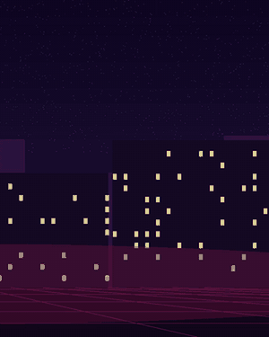 | 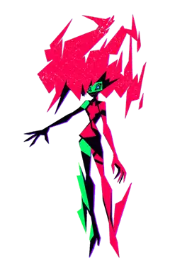 |  | 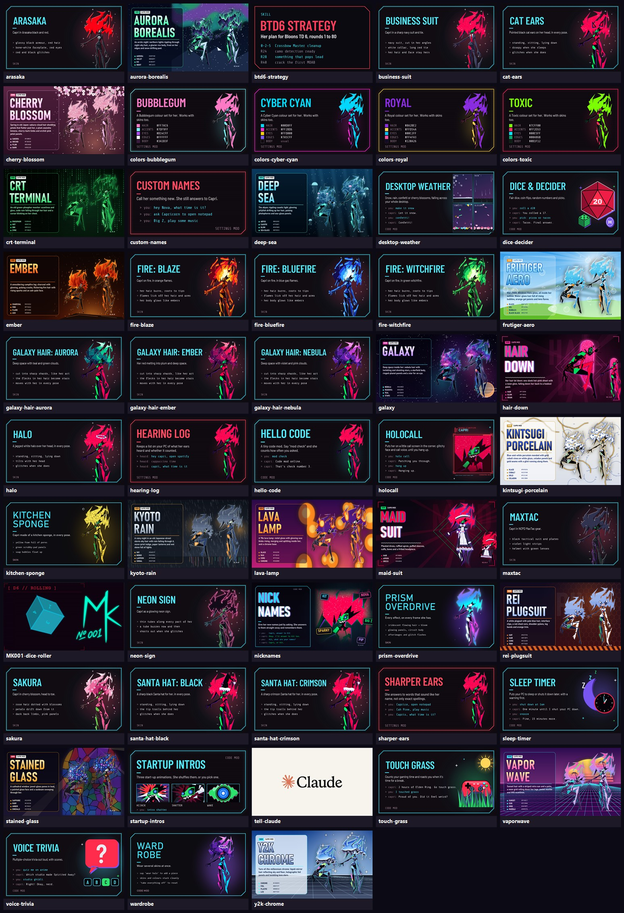 | 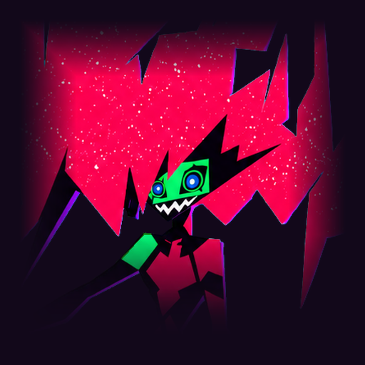 | 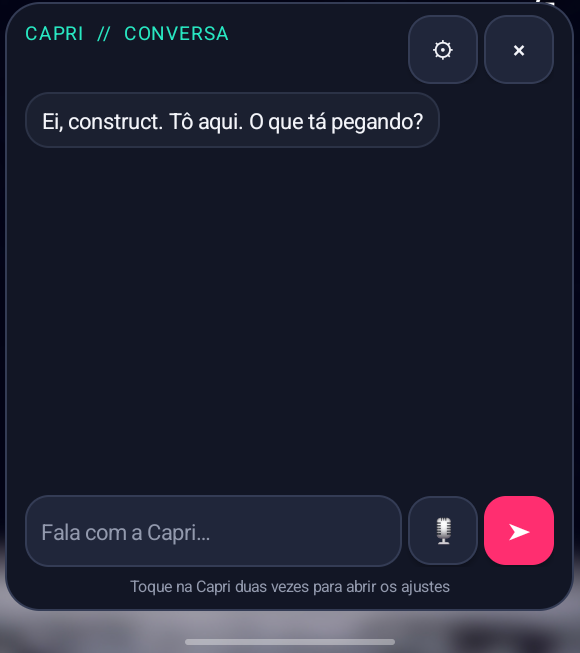 |

<b>Capri antiga / Capri Rápida — animação, fala e passeio</b>

Imagens de apresentação da [versão Python clássica](https://github.com/Capri-cmd/capri-ai).

  
  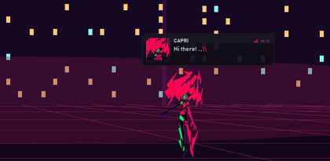
  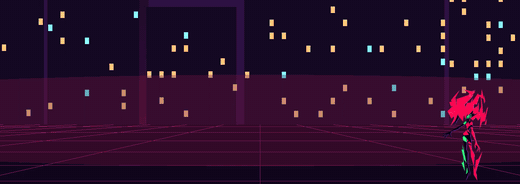
  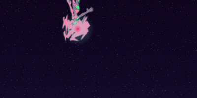
  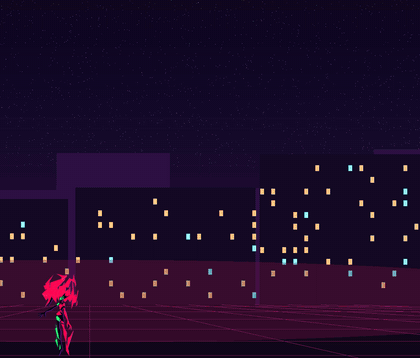

<b>Capri Desktop — sprites, chamadas, painel, mods e mini player</b>

Imagens de apresentação do [repositório Desktop para PC](https://github.com/lachydotmcg/capri-desktop). Inclui os GIFs, sprites e telas ilustrativas que aparecem na documentação do projeto.

  
  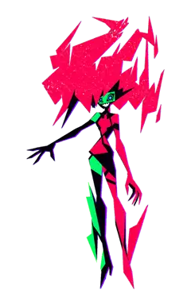
  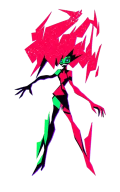
  
  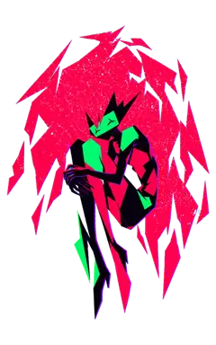
  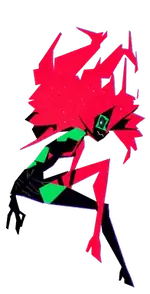
  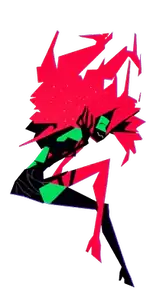
  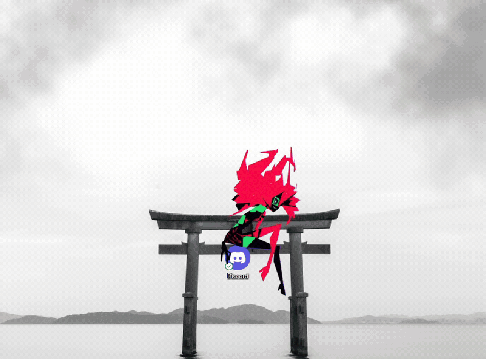
  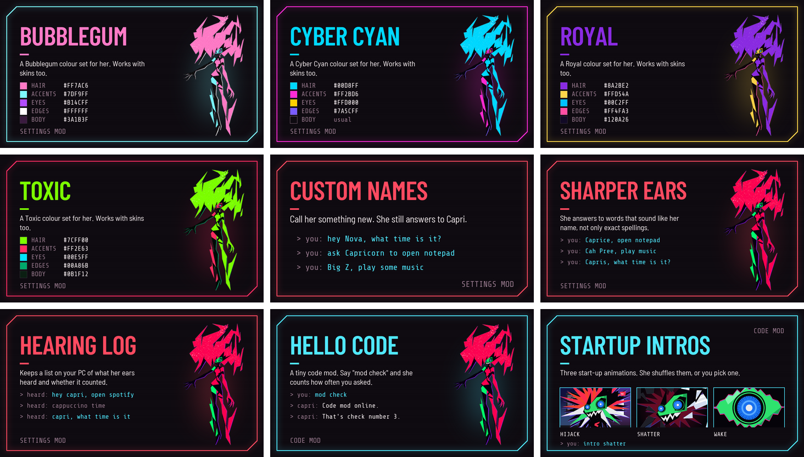
  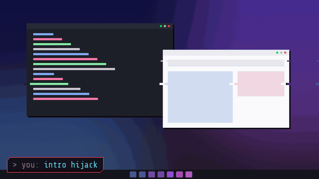

  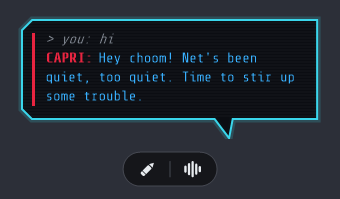
  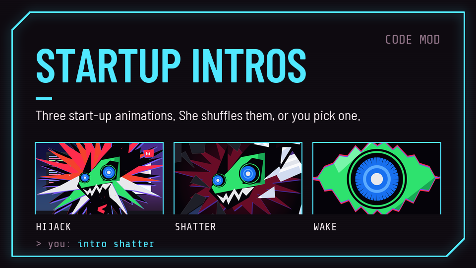
  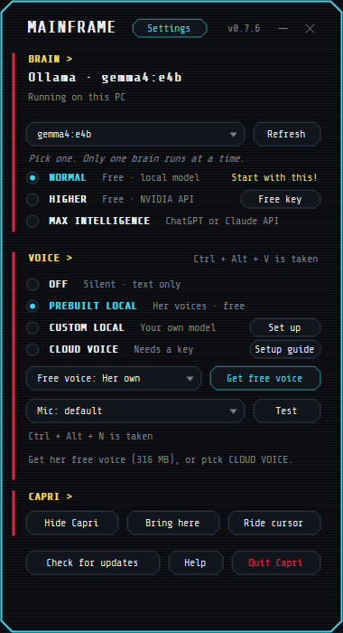
  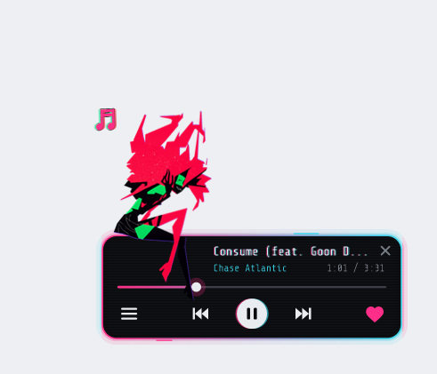
  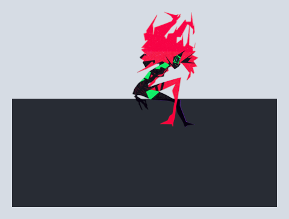
  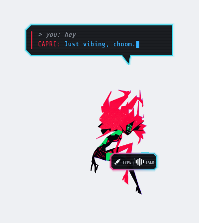
  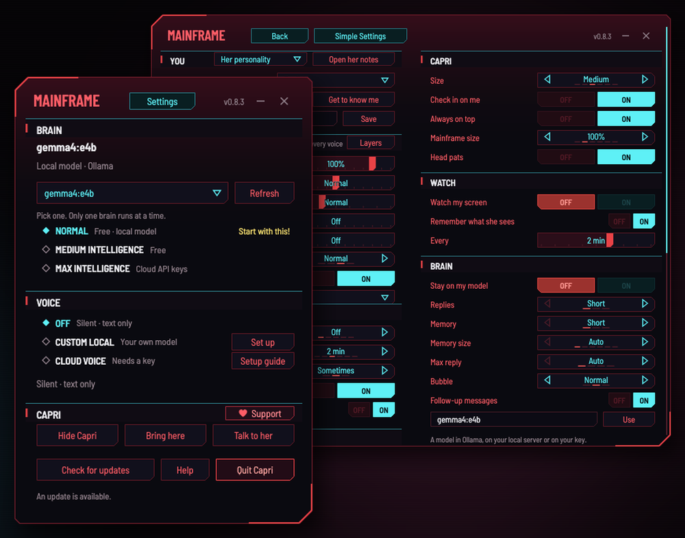

<b>Capri Electron — cenas e expressões</b>

Capturas de demonstração do [projeto Electron](https://github.com/mochiiwuff/capri-desktop).

  
  
  
  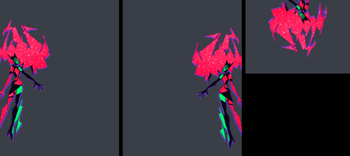
  
  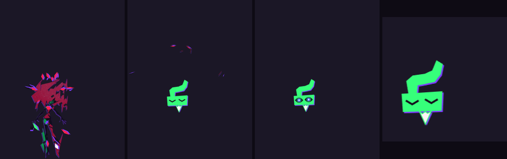
  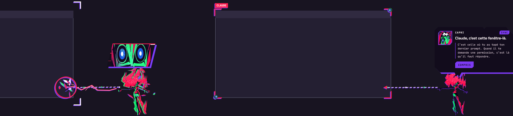
  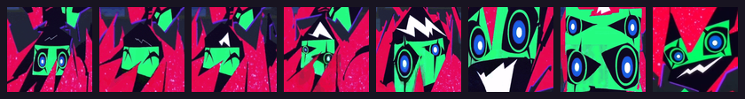
  
  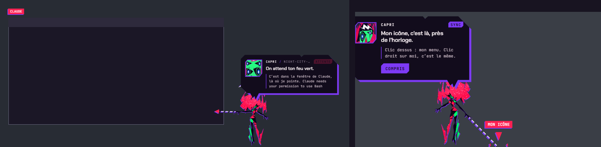
  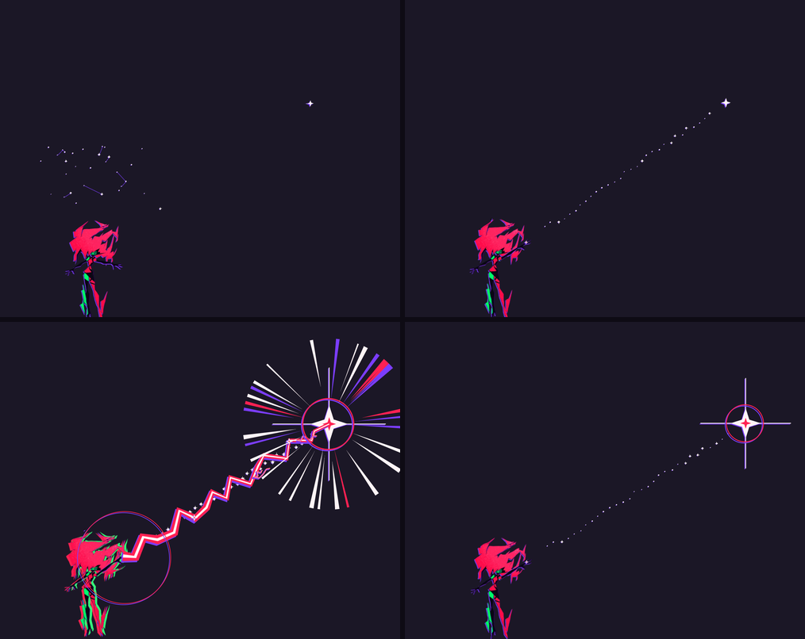
  

<b>Capri Mods — prévias de todos os mods do catálogo</b>

O mosaico reúne as prévias de todos os mods disponíveis no [repositório de mods](https://github.com/lachydotmcg/capri-mods). Os PNGs originais também estão guardados separadamente, um por mod, em [`assets/repositories/capri-mods`](assets/repositories/capri-mods/).

<b>Capri para Android — telas do projeto móvel local</b>

Capturas da versão Android que está no workspace local. Ela tem interface e limites próprios para celular; o código Android ainda não está publicado neste repositório.

  
  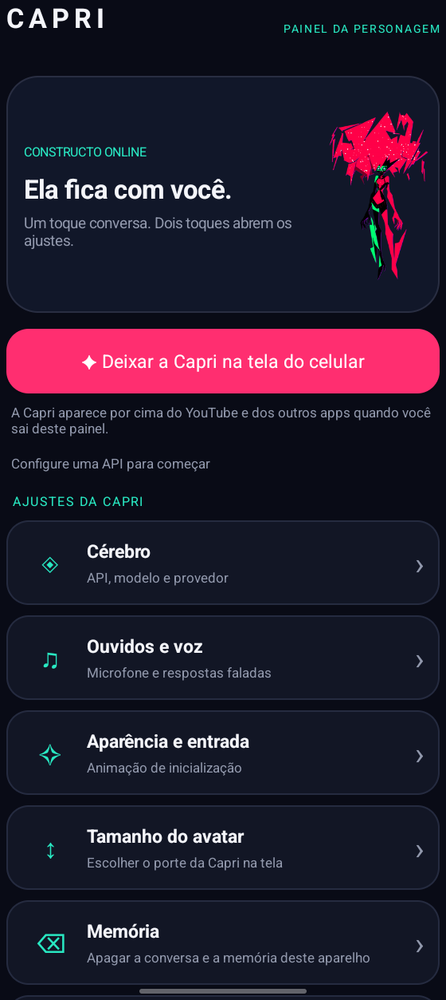

<b>Capri Room VR — ícone e sprites do projeto Quest</b>

Seleção de imagens do [projeto Capri Room VR](https://github.com/fadievr/capri-BD-VR). O repositório VR contém mais sprites de animação; esta galeria mostra exemplos representativos.

  
  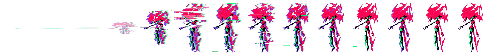
  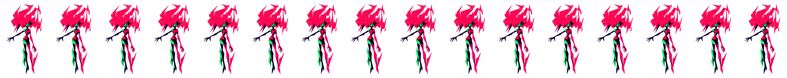
  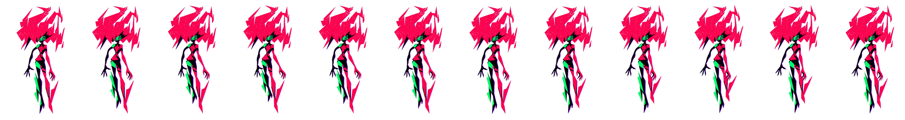
  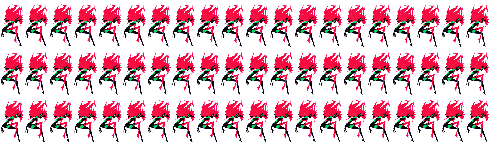

## Download para Windows

O botão baixa o instalador desta modificação de fã. O executável portátil **[Capri.exe](https://github.com/davidanascimento-dot/capri1/raw/refs/heads/main/downloads/0.9.6/Capri.exe)** também está disponível. Os hashes SHA-256 estão em [`SHA256SUMS.txt`](downloads/0.9.6/SHA256SUMS.txt).

A validação dos pacotes de reconhecimento de fala foi atualizada para corresponder aos arquivos servidos atualmente pelo sherpa-onnx.

Veja também as [releases do Capri Desktop](https://github.com/lachydotmcg/capri-desktop/releases) e o [código-fonte upstream](https://github.com/lachydotmcg/capri-desktop).

## O que mudou em relação às referências

| Referência | Como esta build se relaciona | Alterações nesta edição |
| --- | --- | --- |
| [Capri Desktop para PC](https://github.com/lachydotmcg/capri-desktop) | Base principal da aplicação Windows e de sua interface. | Identificação própria como build de fã, versão 0.9.6, falas e legendas de atividade em português e integração de API externa compatível com OpenAI. |
| [Capri antiga / Capri Rápida](https://github.com/Capri-cmd/capri-ai) | Referência separada para sprites e comportamento clássico; alguns recursos/arquivos selecionados são adaptados pela build desktop. | Preset Groq para configurar endpoint, modelo, chave, campo de limite de tokens, nível de raciocínio e máximo de resposta no painel da API externa. |
| [Capri Electron / Code-Husk](https://github.com/mochiiwuff/capri-desktop) | Referência de inspiração e integração; não é a base do executável Windows desta release. | Esta release continua sendo o aplicativo desktop C#; recursos não incorporados não são anunciados como parte dela. |
| [Mods](https://github.com/lachydotmcg/capri-mods) e [Capri Room VR](https://github.com/fadievr/capri-BD-VR) | Projetos relacionados e referências de personalização/realidade mista, não versões empacotadas nesta build para PC. | A lista de recursos instalados continua limitada ao que está presente no executável e no instalador desta release. |

As referências acima não indicam que todo o código ou os assets desses projetos foram copiados. Consulte os créditos e licenças de cada origem antes de redistribuir ou reutilizar materiais.

## O que a Capri reúne

### Presença na área de trabalho

- Sprites e animações da personagem, incluindo a entrada e as expressões disponíveis na build.
- Movimento pela tela, passeio automático, seguir o cursor, sentar em janelas e interagir com as bordas da tela.
- Modo mini com sprites próprios, menu de contexto e retorno ao tamanho normal.
- Opções de tamanho, aparência, movimentos, holograma e visibilidade.
- Ações de repouso, sono, dança e reações configuráveis.

### Conversa e personalização

- Conversa por texto e recursos de voz conforme os componentes configurados.
- Integração com cérebro local ou provedor compatível configurado pela pessoa usuária.
- Memória, clipes, idioma, ajustes de comportamento e opções de privacidade.
- Mods e skins para personalizar aparência e recursos compatíveis.
- Controles no menu para passeio, modo mini, Ouvidos, Aparência, Tamanho, Cérebro, Doar e Ajustes.

### Recursos opcionais

Algumas integrações dependem de configuração e compatibilidade do Windows, dos aplicativos em uso e do provedor escolhido. Entre elas podem estar observar a tela, reagir a jogos, participar de chamadas, usar voz, controlar mídia e conversar com outros serviços. Os itens disponíveis são os que aparecem na build instalada.

## Como usar

1. Baixe e instale a Capri pelo link de Windows acima.
2. Abra o painel da Capri para configurar o cérebro e a voz disponíveis.
3. Clique com o botão direito na personagem para abrir o menu.
4. Use **Passear pela tela** para ligar ou pausar o passeio; no modo mini, o mesmo controle fica no menu de contexto dela.
5. Abra **Ajustes**, **Aparência** e **Tamanho** para personalizar os recursos disponíveis.

## Repositórios Capri consultados

Estes são os projetos Capri identificados nas fontes locais e consultados durante a adaptação. Eles têm autores, versões e licenças próprias; as referências não significam que todo o código ou conteúdo foi incorporado.

| Projeto | Para que serve como referência |
| --- | --- |
| **Esta Capri** — [davidanascimento-dot/capri1](https://github.com/davidanascimento-dot/capri1) | README e apresentação desta adaptação. |
| **Capri antiga / Capri Rápida** — [Capri-cmd/capri-ai](https://github.com/Capri-cmd/capri-ai) | Código Python local da versão clássica; referência para a introdução, sprites, passeio, modo mini, menu e comportamento na área de trabalho. O endereço antigo `Capri-AI` redireciona para este repositório. |
| **Capri Desktop para PC** — [lachydotmcg/capri-desktop](https://github.com/lachydotmcg/capri-desktop) | Versão Desktop em C# usada como base de funcionalidades e interface para Windows. |
| **Mods da Capri** — [lachydotmcg/capri-mods](https://github.com/lachydotmcg/capri-mods) | Catálogo de mods, skins e exemplos de personalização. |
| **Capri Desktop / Code-Husk** — [mochiiwuff/capri-desktop](https://github.com/mochiiwuff/capri-desktop) | Projeto Electron consultado para ideias de integração com assistentes de programação e presença da personagem durante tarefas. |
| **Capri Room VR** — [fadievr/capri-BD-VR](https://github.com/fadievr/capri-BD-VR) | Versão de realidade mista para Quest; projeto relacionado, não parte da versão de PC. |

### Ferramenta auxiliar

[morluto/rea](https://github.com/morluto/rea) é uma ferramenta de engenharia reversa usada como apoio para inspecionar binários. Não é um projeto Capri nem uma dependência do aplicativo.

Também existe uma versão Android local no workspace, com recursos próprios para celular. Ela ainda não tem um repositório remoto identificado, por isso não há um link GitHub para incluir nesta lista.

## Créditos, licença e uso

Capri é um projeto de fã não oficial, sem vínculo ou aprovação da CD PROJEKT RED, dos responsáveis por *Cyberpunk: Edgerunners* ou de seus dubladores. Os nomes, personagens e artes pertencem aos respectivos titulares e criadores.

Antes de redistribuir código, sprites, vozes, mods ou instaladores, confira a licença e os créditos no repositório de origem. A licença de cada componente é independente; este README não substitui nem altera esses termos. Não use o projeto para vender conteúdo de terceiros sem autorização.

A fonte Desktop incluída em [`capri-desktop-source-084/capri-desktop-main`](capri-desktop-source-084/capri-desktop-main/) mantém o `LICENSE.md` e os avisos de atribuição do projeto de origem (PolyForm Noncommercial 1.0.0). Publicar o código aqui não altera essas condições; os componentes e assets de terceiros mantêm suas próprias licenças.

## Privacidade

O comportamento depende das opções ativadas. Um cérebro local pode processar as conversas no próprio computador; quando um provedor online é configurado, mensagens e dados necessários à solicitação podem ser enviados a esse provedor. Revise as opções de tela, voz, chamadas e o aviso de privacidade do serviço escolhido antes de ativá-los.

## Estado da publicação

- O código-fonte da fusão está em `capri-desktop-source-084/capri-desktop-main`.
- O instalador, o executável portátil e seus hashes SHA-256 estão em [`downloads/0.9.6`](downloads/0.9.6/).
- O instalador e as propriedades do executável identificam a edição como uma modificação independente feita por fã.
